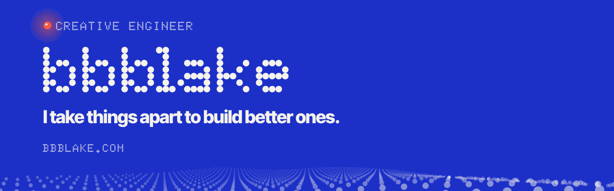

### Hey, I'm Blake.

I take things apart to build better ones.

I'm a creative engineer and Executive Creative Director at AR Marketing in Ohio. I explore ideas until they work, reverse-engineer how things are made, and question the way it's "always been done." These days I direct AI as my builder.

Most of my repos are private. The finished work lives at [bbblake.com](https://bbblake.com).

### Selected work

- **[Kiss Supper Club](https://bbblake.com/work/kiss-supper-club/):** a private chef business I built for my wife's cousin. Three days from first draft to a yes.
- **[Ask Irene](https://bbblake.com/work/ask-irene/):** an AI medical bill advisor for families. Designed, built and launched. Live, with paying users.
- **[A memory AI can't lose](https://bbblake.com/work/agent-brain/):** the system behind all my work. GitHub repos that give every AI session the same rules, a check it can't skip, and rules that improve every session. The [setup guide](https://bbblake.com/work/agent-brain/agent-brain-setup-guide.md) is free.

### How I work

1. **Explore the idea.** Make it real fast, then make it right.
2. **Take it apart.** I learn by reverse-engineering things I admire.
3. **Question the system.** "We've always done it this way" is where I start digging.
4. **Build the better one.** Design, code and launch.

### Say hey

[bbblake.com](https://bbblake.com) · [LinkedIn](https://www.linkedin.com/in/blakermartin) · [Resume](https://bbblake.com/Blake-Martin-Resume.pdf)

Findlay, Ohio. Open to remote leadership roles and select projects.
